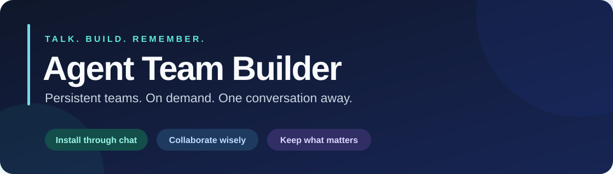

<div align="center">



**Describe your goal. Get the team you need.**

Small tasks stay with one agent. Bigger tasks bring in specialists, with a team you can reuse next session.

[English](README.md) · [简体中文](README.zh-CN.md)

[](https://github.com/houchaoxu/agent-team-builder/actions/workflows/test.yml)
[](https://github.com/houchaoxu/agent-team-builder/releases/latest)


[Get started](#-get-started) · [Features](#-what-you-get) · [How it works](#-how-it-works) · [Documentation](#-go-deeper)

</div>

---

Agent Team Builder gives your development agent a reusable project team: choose specialists for the task, coordinate their work, and keep useful decisions for future sessions.

## 💬 Get started

Open your project in a development agent with file and command tools, then send:

```text
Install the latest stable Agent Team Builder for this project from
https://github.com/houchaoxu/agent-team-builder.
Follow INSTALL.md, handle environment setup,
and verify the installation and host loading status.
```

Your agent installs the complete Skill, prepares its internal tools, and enables the project entry point. **You don't need to run Python, pip, or CLI commands yourself.**

Then ask for what you want to build:

> Add an order management module with an API and frontend, and verify the result.

Once your host loads the project entry, **just describe your task — no need to mention Agent Team Builder again.**

Project installation is the default. Prefer a shared installation? Add **“Install it as a personal Skill.”** Each additional project still needs its own entry enabled. If your host hasn't discovered the Skill yet, your agent will explain whether a new session is needed.

## ✨ What you get

| | Capability | What it means for you |
| --- | --- | --- |
| 🧠 | **A team that persists** | Reuse your project's team in the next session. |
| 🎯 | **The right amount of help** | Small tasks stay with one agent; complex tasks get focused assistance. |
| 🤝 | **Clear ownership** | Dependencies and file boundaries keep parallel work coordinated. |
| 🧩 | **Roles that fit your request** | Your agent's LLM evaluates candidates, presents better-fitting roles for you to choose, and installs after your manual confirmation. |
| 📚 | **Project memory** | Keep useful decisions and lessons, with sources and revision history. |
| 📊 | **Honest execution records** | Track real outcomes and available metrics; unknown values stay unknown. |

### A conversation, not a control panel

| You say… | Your agent handles… |
| --- | --- |
| “Fix this button's color.” | A small change with one agent. |
| “Build the API and frontend.” | A plan, suitable roles, file ownership, and verification. |
| “Find a suitable agent to improve this UI.” | Compare existing roles with the specialist needs, offer candidates to choose from, preview the installation, and wait for your confirmation. |
| “Remember this compatibility rule.” | A sourced project note for future work. |

These are usage examples. Actual delegation depends on the tools and permissions available in your current host.

## 🛠️ How it works

**Talk → choose the smallest useful team → execute → verify → remember.**

The Skill is the user-facing workflow. An optional Python engine handles configuration checks, dependency-aware plans, role installation, and persistent records. The host agent performs the actual model calls and tool work.

| Mode | When to use it |
| --- | --- |
| **Full engine** | Your agent uses Python 3.9+ and prepares dependencies in a private environment when needed. Includes configuration validation, write locks, task state, and metrics. |
| **Basic collaboration** | No Python available? Use host file tools for team instructions and Markdown records. This mode does not provide the engine's validation or write locks. |

Project data stays in `.agent-team/`. Existing project instructions are preserved outside the managed entry block. Installation does not change system Python or your global `PATH`.

The lightweight project entry keeps the workflow small:

1. **Assess the task.** Simple work runs directly, without loading the full Skill or team or scanning roles.
2. **Load only what helps.** For work that benefits from collaboration, read the existing `.agent-team/team.yaml`, selected roles, and relevant task records.
3. **Fill actual gaps.** Consult Marketplace only when existing roles cannot cover the task.
4. **Reuse next session.** Resume the same team without running initialization again.

Automatic routing depends on the host loading the entry. There is no unconditional startup hook or independent scheduling service.

### A fallback library, loaded as needed

The bundled index contains **283 role cards** from a pinned [Agency-Agents](https://github.com/msitarzewski/agency-agents) revision. Your agent checks installed roles first. When a capability is missing, local BM25/keyword retrieval and English/Chinese scenario aliases select **up to six capability cards by default**; your host LLM judges their meaning and fit. No extra model API, vector database, or repository clone is required. An empty retrieval result may need broader terms or another page; it does not prove a suitable role is absent.

**Match → choose a role → preview → confirm → use.** When the host supports interactive questions, candidates appear as clickable choices; otherwise, use a numbered list. Choose a role or skip installation. Profiles are downloaded as needed from a pinned revision, hash-checked, and cached. Your agent shows the source, destination, and write scope, then waits for your explicit confirmation before installing. Selecting a candidate or leaving an option preselected does not approve installation.

**Use the role in your own tool.** Agency-Agents' bundled adapters produce matching role files for supported tools. Agent Team Builder also prepares Skills for Trae and Pi, plus an import package for WorkBuddy. Project installation stays the default where supported; WorkBuddy requires importing the package through its Skills UI. A Skill is not the same as a callable subagent. See the [supported targets and requirements](agent_team/skill/references/agency-installation.md).

If the installed role is not yet callable natively, a supported generic subagent can receive its specialist instructions, or the main agent can follow them sequentially, stating who actually executes the work. The library is MIT-licensed upstream material; attribution and pinned provenance travel with the index and profiles. See the [role workflow](agent_team/skill/references/role-matching.md) for details.

## 📖 Go deeper

- [Installation contract](INSTALL.md) — instructions your agent follows.
- [CLI and engine reference](docs/CLI.md) — for developers and troubleshooting.
- [Skill workflow](agent_team/skill/SKILL.md) — orchestration and progressive loading.
- [Examples](examples/) — task and host input formats for agent tooling.

**Contributions welcome:** reproducible bug reports, host integration results, documentation, and translations. [Open an issue](https://github.com/houchaoxu/agent-team-builder/issues) or send a pull request. Developer setup and test commands are in the [engine reference](docs/CLI.md#验证).

## 🙏 Thanks

Agent Team Builder's role library and multi-agent installation adapters build on the excellent open-source work of [Agency-Agents](https://github.com/msitarzewski/agency-agents). Thank you to its maintainers and contributors for making this role library available. If it helps your workflow, visit the upstream project, give it a ⭐, and support its continued development through issues or contributions.
