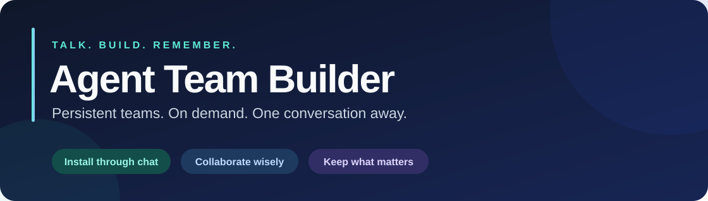

<div align="center">



**Your project. A team that remembers.**

Build persistent, on-demand agent teams — starting with a conversation.

[English](README.md) · [简体中文](README.zh-CN.md)

[](https://github.com/houchaoxu/agent-team-builder/actions/workflows/test.yml)


[Get started](#-get-started) · [Features](#-what-you-get) · [Platforms](#-bring-your-agent) · [Documentation](#-go-deeper)

</div>

---

## 💬 Get started

Open your project in a development agent with file and command tools, then send:

```text
Install Agent Team Builder from https://github.com/houchaoxu/agent-team-builder
for this project. Follow INSTALL.md, handle environment setup,
and verify the installation.
```

Your agent installs the complete Skill, prepares its internal tools, and enables the project entry point. **You don't need to run Python, pip, or CLI commands yourself.**

Then ask for what you want to build:

> Add an order management module. Bring in specialists where useful, and review the result.

Prefer one installation across projects? Add **“Install it as a personal Skill.”** Project installation is the default. If your host hasn't discovered the Skill yet, your agent will explain whether a new session is needed.

## ✨ What you get

| | Capability | What it means for you |
| --- | --- | --- |
| 🧠 | **A team that persists** | Reuse your project's team in the next session. |
| 🎯 | **The right amount of help** | Small tasks stay with one agent; complex tasks get focused assistance. |
| 🤝 | **Clear ownership** | Dependencies and file boundaries keep parallel work coordinated. |
| 🧩 | **Roles that fit your request** | Your agent uses its own LLM to match meaning across languages and role descriptions, with reasons and source quotes. |
| 📚 | **Project memory** | Keep useful decisions and lessons, with sources and revision history. |
| 📊 | **Honest execution records** | Track real outcomes and available metrics; unknown values stay unknown. |

### A conversation, not a control panel

| You say… | Your agent handles… |
| --- | --- |
| “Fix this button's color.” | A small change with one agent. |
| “Build the API and frontend.” | A plan, suitable roles, file ownership, and verification. |
| “Find a database specialist.” | Local role discovery and capability recommendations. |
| “Remember this compatibility rule.” | A sourced project note for future work. |

These are usage examples. Actual delegation depends on the tools and permissions available in your current host.

## 🛠️ How it works

**Talk → choose the smallest useful team → execute → verify → remember.**

The Skill is the user-facing workflow. An optional Python engine handles configuration checks, dependency-aware plans, role installation, and persistent records. The host agent performs the actual model calls and tool work.

| Mode | When to use it |
| --- | --- |
| **Full engine** | Your agent uses Python 3.9+ and prepares dependencies in a private environment when needed. Includes configuration validation, write locks, task state, and metrics. |
| **Basic collaboration** | No Python available? Use host file tools for team instructions and Markdown records. This mode does not provide the engine's locking or validation guarantees. |

Project data stays in `.agent-team/`. Existing project instructions are preserved outside the managed entry block. Installation does not change system Python or your global `PATH`.

## 🌍 Bring your agent

| Host | Project entry | Execution |
| --- | --- | --- |
| **Codex** | `AGENTS.md` | Native subagents when verified; sequential handoffs otherwise. |
| **Claude Code** | `CLAUDE.md` | Host capabilities must be verified in the current session. |
| **Cursor** | Project rules | Uses the features actually available in your version. |
| **Gemini CLI** | `GEMINI.md` | Uses the features actually available in your version. |
| **Other agents** | Explicit Skill/instruction entry | Sequential role prompts and handoffs. |

Codex native delegation has been exercised in a real integration scenario. Other host adapters are provided; their actual discovery and execution still need verification in those hosts. A role file alone is never proof of a callable agent.

## 📖 Go deeper

- [Installation contract](INSTALL.md) — instructions your agent follows.
- [CLI and engine reference](docs/CLI.md) — for developers and troubleshooting.
- [Skill workflow](agent_team/skill/SKILL.md) — orchestration and progressive loading.
- [Validation record](VALIDATION.md) — checks performed and remaining coverage gaps.
- [Examples](examples/) — task and host input formats for agent tooling.

**Contributions welcome:** reproducible bug reports, host integration results, documentation, and translations. [Open an issue](https://github.com/houchaoxu/agent-team-builder/issues) or send a pull request. Developer setup and test commands are in the [engine reference](docs/CLI.md#验证).
