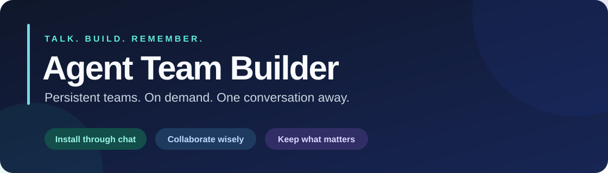

<div align="center">



**说出目标，按需配齐团队。**

小任务独立完成，复杂任务引入专家，下一次会话继续复用已有团队。

[English](README.md) · [简体中文](README.zh-CN.md)

[](https://github.com/houchaoxu/agent-team-builder/actions/workflows/test.yml)
[](https://github.com/houchaoxu/agent-team-builder/releases/latest)


[开始使用](#-一句话开始) · [功能亮点](#-你会得到什么) · [工作方式](#-它如何工作) · [更多文档](#-继续了解)

</div>

---

Agent Team Builder 希望让专业团队协作通过对话就能完成：在你使用的开发 Agent 中安装，说出目标，按需选择专家，并在后续会话中复用团队。

## 💬 一句话开始

在具有文件与命令工具的开发 Agent 中打开项目，然后告诉它：

```text
请从 https://github.com/houchaoxu/agent-team-builder
为当前项目安装 Agent Team Builder 最新稳定版。
按照仓库的 INSTALL.md 识别当前工具及会话能力，
选择对应安装方式，并验证哪些能力已经可用。
```

Agent 会检查当前环境，选择对应适配器安装完整 Skill，并准备项目入口。若宿主需要导入或重新加载，Agent 会说明剩余步骤。**你无需手动运行 Python、pip 或 CLI 命令。**

最新稳定版 **v2.8.0** 已包含下文介绍的能力协商与宿主适配协作路由。

之后，直接说你想做什么：

> 帮我完成订单管理模块的 API 和前端页面，并验证结果。

宿主加载项目入口后，**直接描述任务即可，无需再提及 Agent Team Builder。**

默认安装到当前项目。希望跨项目共用一份安装？补充一句 **“安装成我个人可用的 Skill”**，其他项目仍需分别启用项目入口。若宿主尚未发现新 Skill，Agent 会说明是否需要重新打开会话。

## ✨ 你会得到什么

| | 能力 | 对你的帮助 |
| --- | --- | --- |
| 🧠 | **团队长期保存** | 下次打开项目，继续复用已有团队。 |
| 🎯 | **按需选择成员** | 小任务由一个 Agent 完成，复杂任务再找帮手。 |
| 🤝 | **明确分工边界** | 根据依赖与文件归属协调并行工作。 |
| 🔌 | **按宿主能力协作** | 核对当前工具，选择原生、通用或临时子 Agent；分别验证安装与实际调用。 |
| 🧩 | **按需补齐角色** | 由当前 Agent 的 LLM 判断候选，展示更合适的角色供你选择，手动确认后安装。 |
| 📚 | **沉淀项目知识** | 保存有来源的决策与经验，并保留修订历史。 |
| 📊 | **如实记录结果** | 记录真实交付与可取得的指标，未测数据保持未知。 |

### 你负责表达目标，Agent 负责安排

| 你说…… | Agent 处理…… |
| --- | --- |
| “改一下按钮颜色。” | 主 Agent 直接完成小改动。 |
| “开发这个模块的前后端。” | 拆解任务、选择角色、约定文件边界并验收。 |
| “找一个合适的 Agent 来优化这个界面。” | 比较现有角色与专业需求，展示候选供点选，预览并等待你确认安装。 |
| “记住这个接口兼容约定。” | 保存带来源的项目知识，供后续工作参考。 |

以上为使用示例。实际委派取决于当前宿主提供的工具与权限。

## 🛠️ 它如何工作

**描述目标 → 选择必要成员 → 执行任务 → 验证结果 → 保留有用知识。**

Skill 提供面向用户的工作流程；可选的 Python 引擎负责配置校验、依赖编排、角色安装和持久化记录。实际模型调用与工具执行由宿主 Agent 完成。

| 模式 | 适用情况 |
| --- | --- |
| **完整引擎** | Agent 使用已有 Python 3.9+，必要时自动准备私有依赖环境；提供配置校验、写锁、任务状态与指标统计。 |
| **基础协作** | 没有 Python 时，使用宿主文件工具维护团队指令和 Markdown 记录；不具备完整引擎的校验与写锁保障。 |

项目数据保存在 `.agent-team/`。已有项目指令在托管入口块之外的内容会保留。安装不修改系统 Python，也不改全局 `PATH`。

轻量项目入口让每次使用都按需展开：

1. **先判断任务。** 简单任务直接完成，不加载完整 Skill 或团队，也不扫描角色。
2. **只读需要的内容。** 确有协作收益时，才读取已有 `.agent-team/team.yaml`、选中角色和相关任务记录。
3. **有缺口再补齐。** 现有角色无法覆盖任务时，才检索 Marketplace。
4. **下次继续复用。** 恢复同一团队，不重复运行初始化。

自动判断依赖宿主加载项目入口；没有无条件启动钩子或独立调度后台。

### 同一种用法，适配不同 Agent

**用户通过对话开始，安装与执行方式随当前宿主调整。** Codex、Claude Code、WorkBuddy、Trae、Pi 等工具，以及同一工具的不同版本或会话，提供的能力可能不同。Agent 先核对实际可用工具，再选择协作方式。

| 当前具备的能力 | 团队如何执行 |
| --- | --- |
| 有可调用的专业 Agent | 直接委派给原生专业角色。 |
| 有能接收角色指令的通用子 Agent | 将选中专家的指令和任务交给它。 |
| 能按任务创建临时 Agent | 为本次任务创建专业执行者。 |
| 暂无可用委派方式 | 按角色指令顺序执行，并说明限制。 |

共享核心负责角色检索、团队与任务记录；宿主适配器负责格式和安装，当前会话证据决定执行路径。**Skill 安装成功，不等于专家已经注册或可调用。** 宿主发现、角色注册、实际调用与结果返回分别验证；未核实的能力保持未知。具体产品的原生集成仍需在你使用的版本中验证。

团队可以跨会话、跨工具复用，可调用角色和权限则按需核对。简单任务不会因此增加扫描和诊断。[了解宿主适配方式 →](agent_team/skill/references/host-capabilities.md)

### 按需加载的后备素材库

内置固定版本 [Agency-Agents](https://github.com/msitarzewski/agency-agents) 的 **283 张角色卡**，是唯一默认后备角色库。Agent 先检查项目团队和 Agent Team Builder 管理的当前宿主安装角色；有能力缺口时，再用本地 BM25 / 关键词检索和中英文场景别名，**默认筛出最多 6 张能力卡**，交给宿主 LLM 判断含义与适用性。默认不会扫描 Codex、Claude Code 等工具的个人角色目录；用户明确要求导入本地素材时才指定来源。无需额外模型 API、向量库或 clone 素材仓库。检索为空时可能需要补充词义或翻页，不能直接断言没有合适角色。

**匹配 → 选择角色 → 预览安装 → 手动确认 → 使用。** 宿主支持交互问答时提供可点击的候选列表，否则提供编号列表；你可以选择角色，也可以跳过安装。完整资料按需从固定 revision 下载，校验 hash 并缓存复用。Agent 展示来源、目标位置与写入范围，收到你对具体安装的明确确认后才写入；选中候选或默认预选不等于同意安装。

**同一套角色，适配你正在使用的工具。** 选中的 Agency 资料提供专业角色指令，当前宿主决定安装格式与执行方式。支持项目安装的目标默认安装到当前项目。具体见[安装目标](agent_team/skill/references/agency-installation.md)与[角色工作流](agent_team/skill/references/role-matching.md)。索引和角色保留上游 MIT 署名与固定版本来源。

## 📖 继续了解

- [安装契约](INSTALL.md)：交给 Agent 阅读并执行。
- [CLI 与引擎参考](docs/CLI.md)：开发、排障时按需查看。
- [Skill 工作流](agent_team/skill/SKILL.md)：任务编排与分层加载。
- [输入示例](examples/)：供 Agent 内部工具使用的任务和宿主格式。

**欢迎参与：** 提交可复现的问题、平台集成结果、文档改进或翻译。可以[创建 Issue](https://github.com/houchaoxu/agent-team-builder/issues)或提交 Pull Request。开发环境与测试命令见[引擎参考](docs/CLI.md#验证)。

## 🙏 致谢与支持

Agent Team Builder 的角色素材库和多宿主安装适配能力，基于优秀的开源项目 [Agency-Agents](https://github.com/msitarzewski/agency-agents)。感谢它的维护者和贡献者分享这套角色库。如果它也对你的工作有帮助，欢迎前往上游项目点亮 ⭐，并通过提交 Issue 或贡献代码支持项目持续发展。
