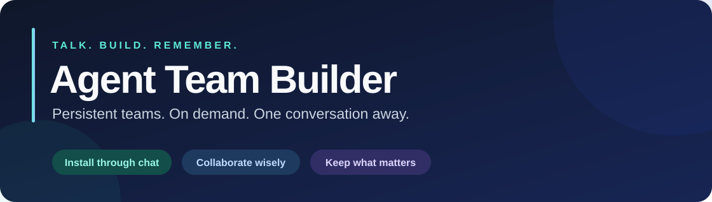

<div align="center">



**你的项目，拥有一支持续记得它的团队。**

从一句话开始，让 Agent 团队按需协作、跨会话复用。

[English](README.md) · [简体中文](README.zh-CN.md)

[](https://github.com/houchaoxu/agent-team-builder/actions/workflows/test.yml)


[开始使用](#-一句话开始) · [功能亮点](#-你会得到什么) · [平台支持](#-带上你熟悉的-agent) · [更多文档](#-继续了解)

</div>

---

## 💬 一句话开始

在具有文件与命令工具的开发 Agent 中打开项目，然后告诉它：

```text
请从 https://github.com/houchaoxu/agent-team-builder
安装 Agent Team Builder，为当前项目启用。
按照 INSTALL.md 完成环境准备，并验证可以使用。
```

Agent 会安装完整 Skill、准备内部工具并设置项目入口。**你无需手动运行 Python、pip 或 CLI 命令。**

之后，直接说你想做什么：

> 帮我完成订单管理模块，需要时找合适的专家协作，最后检查结果。

希望所有项目都能用？补充一句 **“安装成我个人可用的 Skill”**。默认只安装到当前项目。若宿主尚未发现新 Skill，Agent 会说明是否需要重新打开会话。

## ✨ 你会得到什么

| | 能力 | 对你的帮助 |
| --- | --- | --- |
| 🧠 | **团队长期保存** | 下次打开项目，继续复用已有团队。 |
| 🎯 | **按需选择成员** | 小任务由一个 Agent 完成，复杂任务再找帮手。 |
| 🤝 | **明确分工边界** | 根据依赖与文件归属协调并行工作。 |
| 🧩 | **按需补齐角色** | 先评估已安装角色，不足时检索内置后备素材索引，由当前 Agent 的 LLM 判断候选是否适合。 |
| 📚 | **沉淀项目知识** | 保存有来源的决策与经验，并保留修订历史。 |
| 📊 | **如实记录结果** | 记录真实交付与可取得的指标，未测数据保持未知。 |

### 你负责表达目标，Agent 负责安排

| 你说…… | Agent 处理…… |
| --- | --- |
| “改一下按钮颜色。” | 主 Agent 直接完成小改动。 |
| “开发这个模块的前后端。” | 拆解任务、选择角色、约定文件边界并验收。 |
| “团队缺数据库专家时，帮我找并安装合适的角色。” | 先评估现有角色，再检索素材、预览并在授权范围内安装。 |
| “记住这个接口兼容约定。” | 保存带来源的项目知识，供后续工作参考。 |

以上为使用示例。实际委派取决于当前宿主提供的工具与权限。

## 🛠️ 它如何工作

**描述目标 → 选择必要成员 → 执行任务 → 验证结果 → 保留有用知识。**

Skill 提供面向用户的工作流程；可选的 Python 引擎负责配置校验、依赖编排、角色安装和持久化记录。实际模型调用与工具执行由宿主 Agent 完成。

| 模式 | 适用情况 |
| --- | --- |
| **完整引擎** | Agent 使用已有 Python 3.9+，必要时自动准备私有依赖环境；提供配置校验、写锁、任务状态与指标统计。 |
| **基础协作** | 没有 Python 时，使用宿主文件工具维护团队指令和 Markdown 记录；不具备完整引擎的写锁与校验保障。 |

项目数据保存在 `.agent-team/`。已有项目指令在托管入口块之外的内容会保留。安装不修改系统 Python，也不改全局 `PATH`。

### 按需加载的后备素材库

2.5.0 内置 [Agency-Agents](https://github.com/msitarzewski/agency-agents) 的轻量角色索引。Agent 先检查已安装角色；有能力缺口时，再用本地关键词和中英文场景别名默认筛出最多 6 张能力卡，交给宿主 LLM 判断含义与适用性。无需向量库、新模型 API 或 clone 仓库。检索为空时可能需要补充词义或翻页，不能直接断言没有合适角色。

选中后才按固定 revision 下载完整角色，校验索引中的 hash，并缓存复用。安装先预览，只在已有授权或用户确认后写入；用户已要求自动寻找并安装缺失专家时，可在该授权范围内连续完成。安装角色文件不代表当前宿主能立即调用新的原生 Agent。上游素材采用 MIT 许可证，索引和角色保留署名与固定版本来源。详细流程见[语义角色推荐](agent_team/skill/references/role-matching.md)。

## 🌍 带上你熟悉的 Agent

| 宿主 | 项目入口 | 执行方式 |
| --- | --- | --- |
| **Codex** | `AGENTS.md` | 验证能力后使用原生子 Agent，否则顺序交接。 |
| **Claude Code** | `CLAUDE.md` | 以当前会话实际提供的能力为准。 |
| **Cursor** | 项目 Rules | 使用当前版本实际具备的功能。 |
| **Gemini CLI** | `GEMINI.md` | 使用当前版本实际具备的功能。 |
| **其他 Agent** | 显式 Skill / 指令入口 | 角色 Prompt 与顺序工作流。 |

Codex 原生委派已完成真实集成验收。其他平台提供了适配器，实际发现与执行仍需在对应宿主验证。角色文件存在，不代表角色已经可以调用。

## 📖 继续了解

- [安装契约](INSTALL.md)：交给 Agent 阅读并执行。
- [CLI 与引擎参考](docs/CLI.md)：开发、排障时按需查看。
- [Skill 工作流](agent_team/skill/SKILL.md)：任务编排与分层加载。
- [验证记录](VALIDATION.md)：已执行的检查与覆盖缺口。
- [输入示例](examples/)：供 Agent 内部工具使用的任务和宿主格式。

**欢迎参与：** 提交可复现的问题、平台集成结果、文档改进或翻译。可以[创建 Issue](https://github.com/houchaoxu/agent-team-builder/issues)或提交 Pull Request。开发环境与测试命令见[引擎参考](docs/CLI.md#验证)。
